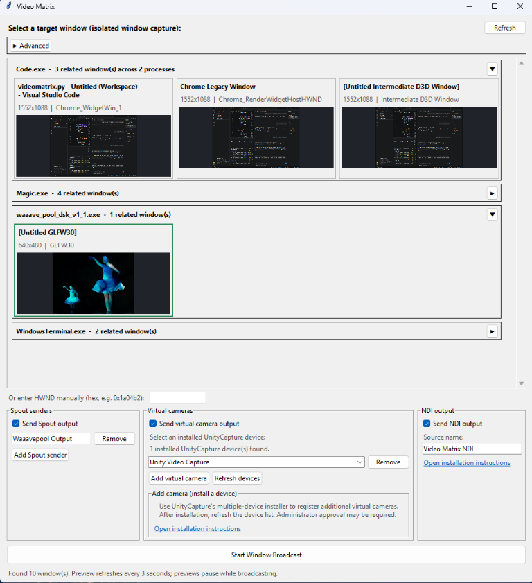

# VideoMatrix

Video Matrix works on Windows only and requires 64-bit Python 3.11 or newer.
[Download Python for Windows](https://www.python.org/downloads/windows/) and
enable **Add python.exe to PATH** during installation.

## Example



## Install and run

1. On GitHub, click **Code > Download ZIP**.
2. Unzip the downloaded file.
3. Open PowerShell and navigate to the unzipped folder containing
   `requirements.txt` and `videomatrix.py`. For example:

   ```powershell
   cd "C:\path\to\unzipped\videomatrix"
   ```

4. Install the requirements and run Video Matrix:

   ```powershell
   python -m pip install -r requirements.txt
   python videomatrix.py
   ```

Virtual camera output requires UnityCapture to be installed separately.

NDI output requires the NDI SDK to be installed separately:
https://ndi.video/for-developers/ndi-sdk/download/
